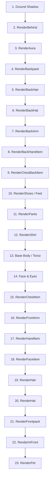

# Character Rendering Architecture

In Growtopia, player avatars and outfits are not rendered as single flattened images. The game client utilizes a real-time **2D skeletal sprite compositor** that layers segmented body parts, clothing items, particle emitters, and accessories in a strict Z-order hierarchy.

Third-party web tools (such as static set planners) typically rely on a backend image server that pastes cropped sprites into a single flat canvas with hardcoded exceptions. Replicating the authentic in-game visual fidelity and animation requires implementing the client's actual multi-pass layering and procedural skeletal transform pipeline.

---

## 1. Base Character Anatomy

The default unequipped character ("naked Growtopian") consists of separate body parts rendered on a **32 × 32 pixel** grid coordinate system:

| Body Part | Asset File | Grid Cell / Dimensions | Description |
|---|---|---|---|
| **Head Base** | `game/player_head.rttex` | 32 × 32 | Skull base, ears, and base skin tone. Tinted by skin color (or `player_head_skin1..12.rttex`). |
| **Torso** | `game/player_body_only.rttex` | 32 × 32 | Upper torso and chest. |
| **Arms (Left & Right)** | `game/player_arm.rttex` | 32 × 32 | Upper arm, forearm, and hand. Modulated by skin color. |
| **Sleeves** | `game/player_sleeve.rttex` | 32 × 32 | Drawn over arms when wearing shirts or jackets. |
| **Feet & Legs** | `game/player_feet.rttex` | 32 × 32 | Bare feet and leg stride frames. |
| **Eyes & Blink** | `game/player_eyes.rttex` | 32 × 32 | 3-frame eye blink animation (Open, Half, Closed). |
| **Eye Iris** | `game/player_iris1.rttex` | 32 × 32 | Tinted eye pupil overlay (Contact Lenses). |
| **Mouth & Expression** | `game/player_face.rttex` | 32 × 32 | Neutral, smiling, frowning, open mouth, or talking frames. |
| **Punch Extension** | `game/player_puncharm.rttex` | 32 × 32 | Extended fist arm frame triggered during punch actions. |

<Callout type="info" title="32x32 Pixel Standard">
All player body parts, hair sprites, and clothing items are authored within 32 × 32 pixel cells on their respective spritesheets.
</Callout>

---

## 2. The 23-Layer Z-Order Rendering Pipeline

The client binary (`AvatarRenderer`) draws character components and clothing in the following exact Z-order sequence (from back to front):

### Layer Breakdown

1. **Ground Shadow:** Elliptical drop shadow projected onto the tile beneath the player. Suppressed if `RENDER_OBJECT_FLAG_NO_SHADOWS` is active or if hovering at high altitude.
2. **`RenderBehind`:** Rear components of complex mounts, chariots, chairs, or vehicles (e.g., rear bike wheel in *Bone Bike*).
3. **`RenderAura`:** Full-body aura effects, glowing halos, and swirling elemental particle fields (e.g., *Infinity Aura*, *Beach Aura*).
4. **`RenderBackpack`:** Wings, capes, jetpack thrusters, and quivers worn on the back (`clothing_type = 7`).
5. **`RenderBackHair`:** Rear layer of long or cascading hair styles drawn behind the shoulders.
6. **`RenderBackHat`:** Back brims, rear ribbons, and interior hood textures.
7. **`RenderBackArm`:** Rear arm limb and rear sleeve. Swings opposite to the front arm during movement.
8. **`RenderBackHandItem`:** Items held in the rear hand (shields, off-hand weapons, dual-wield blades).
9. **`RenderChestBackItem`:** Straps, harness bands, and bandoliers wrapping around the back of the torso.
10. **`RenderShoes`:** Footwear (`clothing_type = 4`) and feet. Can be replaced entirely by `RenderShoesWithMermaidTail` or suppressed by `RENDER_OBJECT_FLAG_NO_FEET`.
11. **`RenderPants`:** Legwear and skirts (`clothing_type = 3`). Suppressed by `RENDER_OBJECT_FLAG_NO_LEGS` or long robes.
12. **`RenderShirt`:** Torso clothing, armor, and vests (`clothing_type = 2`).
13. **Base Body:** Core torso skin and neck connecting to the head.
14. **Face & Eyes:** Mouth expression (`player_face.rttex`), blinking eye animation (`player_eyes.rttex`), and tinted iris overlay.
15. **`RenderChestItem`:** Necklaces, scarves, ties, badges, and amulets (`clothing_type = 9`).
16. **`RenderFrontArm`:** Front arm limb, front sleeve, or punch extension arm.
17. **`RenderHandItem`:** Primary handheld tools, weapons, wands, and pickaxes (`clothing_type = 6`).
18. **`RenderFaceItem`:** Glasses, sunglasses, masks, beards, and snout accessories (`clothing_type = 5`).
19. **`RenderHair`:** Front hair bangs, cowlicks, and crests (`clothing_type = 8`).
20. **`RenderHat`:** Headwear, helmets, caps, and crowns (`clothing_type = 1`).
21. **`RenderFrontpack`:** Front harnesses, aprons, front plushies, and chest rigs.
22. **`RenderInFront`:** Front chassis of mounts, steering wheels, vehicle dashboards, and handlebars.
23. **`RenderPet`:** Floating pet companions, orbital familiars, and flying drones (`item_type = 28` or ItemRenderer pet hooks).

---

## 3. Clothing Slot Types in `items.dat`

The numeric `clothing_type` field in `items.dat` maps an item to its primary body slot:

| `clothing_type` | Slot Name | Typical Spritesheet | Layer Pass |
|---|---|---|---|
| `0` | None | N/A | Non-wearable item |
| `1` | **Hat** | `player_cosmetics*.rttex` | `RenderHat` / `RenderBackHat` |
| `2` | **Shirt** | `player_shirt*.rttex` | `RenderShirt` |
| `3` | **Pants** | `player_pants*.rttex` | `RenderPants` |
| `4` | **Shoes** | `player_feet*.rttex` | `RenderShoes` |
| `5` | **Face** | `player_faceitem*.rttex` | `RenderFaceItem` |
| `6` | **Hand** | `player_handitem*.rttex` | `RenderHandItem` / `RenderBackHandItem` |
| `7` | **Back** | `player_back*.rttex` | `RenderBackpack` |
| `8` | **Hair** | `player_hair*.rttex` | `RenderHair` / `RenderBackHair` |
| `9` | **Chest** | `player_chestitem*.rttex` | `RenderChestItem` |

<Callout type="warn" title="Ancestral Items">
Ancestral Artifacts (e.g., *Ancestral Lens of Riches*) use `item_type = 36` rather than a standard `clothing_type`. They are equipped in a dedicated 10th slot and hook directly into `RenderAura` and particle emitter updates.
</Callout>
